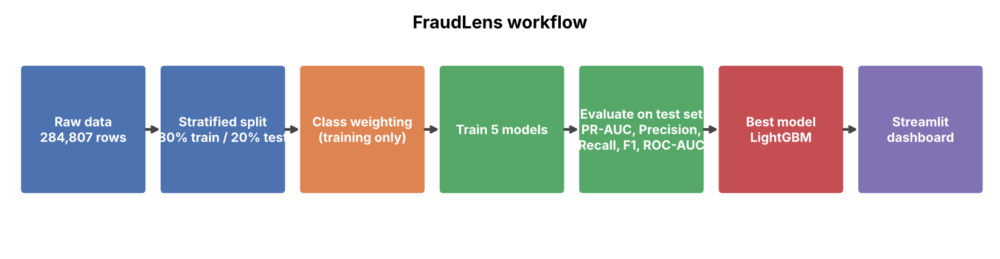
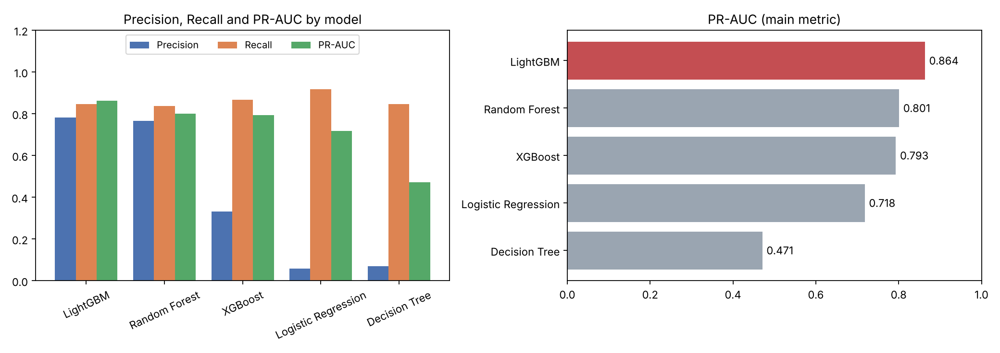
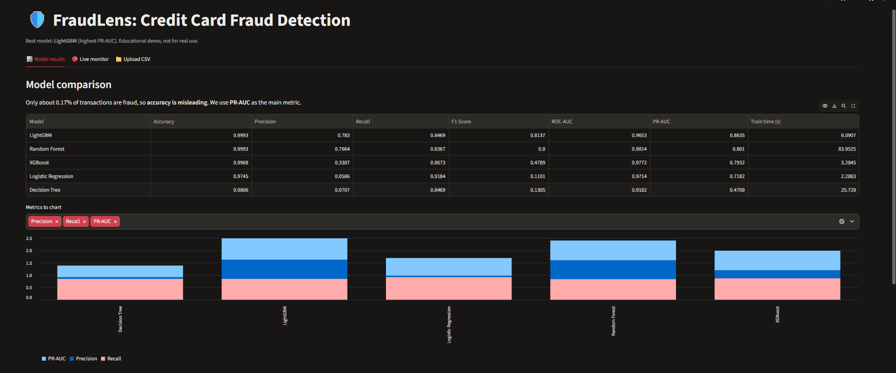
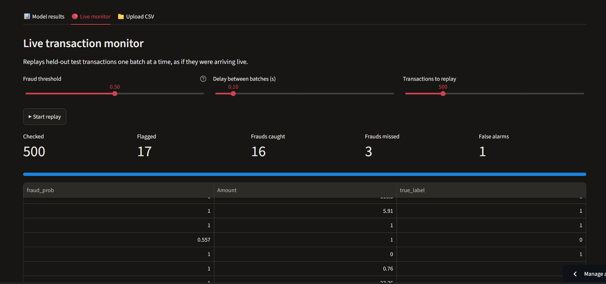
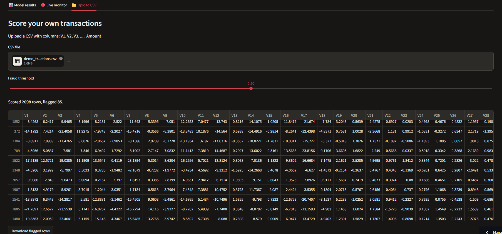

<div align="center">

# 🛡️ FraudLens
### Credit Card Fraud Detection with Machine Learning

*Finding 1 fraud in 600 transactions, without drowning in false alarms.*

[](https://credit-card-fraud-detection-qun2mqxnoqubxtg56zjzkw.streamlit.app)


**[🔴 Try the live dashboard](https://credit-card-fraud-detection-qun2mqxnoqubxtg56zjzkw.streamlit.app)**

</div>

---

**Contents:** [Overview](#-overview) · [Highlights](#-key-highlights) · [Dataset](#-dataset) · [Approach](#-approach) · [Results](#-results) · [Key Findings](#-key-findings) · [Dashboard](#%EF%B8%8F-the-dashboard) · [Run it](#-run-it-yourself) · [Limitations](#%EF%B8%8F-limitations)

---

## 📌 Overview

Credit card fraud costs banks and customers billions every year, yet fraudulent transactions are extremely rare: **only 492 of 284,807 transactions (0.17%)** in this dataset. That imbalance is the real challenge. A model that labels everything "genuine" scores **99.83% accuracy while catching zero fraud**.

**FraudLens** is an end-to-end machine learning project that:

1. Explores and prepares a highly imbalanced fraud dataset.
2. Handles the imbalance with **class weighting**.
3. Compares **five models**: Logistic Regression, Decision Tree, Random Forest, XGBoost and LightGBM.
4. Evaluates them with metrics that suit rare events, led by **PR-AUC**.
5. Deploys the best model in an interactive **Streamlit dashboard** with a live transaction monitor.

> **Result:** LightGBM was the best model, with **PR-AUC 0.864**, **precision 0.78** and **recall 0.85**. It catches about 85% of fraud while raising only about 23 false alarms among roughly 56,900 test transactions.

---

## 🎯 Key Highlights

| | |
|---|---|
| ⚖️ **Imbalance handled properly** | Class weighting (`class_weight`, `scale_pos_weight`) with no data deleted or invented |
| 📏 **Right metric** | PR-AUC as the main metric, because accuracy is misleading at 0.17% fraud |
| 🤖 **Five models compared** | Linear, single tree, bagging and two gradient-boosting libraries |
| 🔴 **Live monitor** | Replays unseen test transactions in real time with counters and a flagged-transactions table |
| 🎚️ **Adjustable threshold** | Slider shows the precision vs recall trade-off live |
| 📁 **Score your own data** | Upload a CSV, get flagged rows, download the results |
| 🪶 **Lightweight** | Saved model is only ~153 KB, so deployment is fast |

---

## 📊 Dataset

**Source:** [Kaggle: Credit Card Fraud Detection](https://www.kaggle.com/datasets/mlg-ulb/creditcardfraud), collected by Worldline and the Machine Learning Group of ULB. It contains European cardholder transactions from two days in September 2013.

| Property | Value |
|---|---|
| Transactions | 284,807 |
| Fraud cases | 492 (**0.172%**) |
| Features | `Time`, `V1`–`V28`, `Amount` |
| Target | `Class` (1 = fraud, 0 = genuine) |

- `V1`–`V28` are **anonymised PCA components**, so the original features are hidden for privacy.
- `Time` is seconds since the first transaction; `Amount` is the transaction value.
- The raw file (144 MB) is **not included** in this repo. Download it from Kaggle to rerun the notebook.

---

## 🔬 Approach



### 1. Preprocessing
- **Stratified 80/20 split** (`random_state=42`): about 227,845 training and 56,962 test transactions, with the same 0.17% fraud rate in both.
- Logistic Regression uses a `StandardScaler` **inside a pipeline**, so scaling is learned from training data only (no leakage). Tree-based models don't need scaling.
- The model uses `V1`–`V28` and `Amount` as inputs (`Time` is not used as a feature). It takes raw columns directly, so the app needs no separate scaler.

### 2. Handling class imbalance: class weighting
Instead of oversampling or undersampling, each model is told that **missing a fraud costs far more than missing a genuine transaction**:
- `class_weight` for Logistic Regression, Decision Tree, Random Forest and LightGBM
- `scale_pos_weight` for XGBoost

This keeps every real transaction, creates no synthetic data, and is simple to explain.

### 3. Models compared
| Model | Why it's included |
|---|---|
| Logistic Regression | Simple, interpretable baseline |
| Decision Tree | A single tree, showing the limits of one model |
| Random Forest | Many trees (50, depth 10) averaged to reduce overfitting |
| XGBoost | Popular gradient boosting (100 trees) |
| LightGBM | Fast gradient boosting (100 trees) built for large tabular data |

### 4. Why these metrics?
| Metric | Why it matters here |
|---|---|
| **PR-AUC (main)** | Focuses on the rare fraud class, so it is not inflated by the huge number of easy genuine cases |
| **Recall** | Share of real frauds we catch |
| **Precision** | Share of flagged transactions that are truly fraud (low precision means many annoyed customers) |
| **F1** | Balance of precision and recall |
| ROC-AUC | Overall ranking quality (can look optimistic on imbalanced data) |
| Accuracy | Reported only to show it is **misleading** (even a useless model scores ~99.8%) |

---

## 🏆 Results

Evaluated on the held-out test set (56,962 transactions, 98 frauds):

| Model | Accuracy | Precision | Recall | F1 | ROC-AUC | **PR-AUC** | Train time (s) |
|---|---|---|---|---|---|---|---|
| 🥇 **LightGBM** | 0.9993 | **0.783** | 0.847 | **0.814** | 0.965 | **0.864** | 6.1 |
| Random Forest | 0.9993 | 0.766 | 0.837 | 0.800 | **0.981** | 0.801 | 84.0 |
| XGBoost | 0.9968 | 0.331 | 0.867 | 0.479 | 0.977 | 0.793 | 3.3 |
| Logistic Regression | 0.9745 | 0.059 | **0.918** | 0.110 | 0.971 | 0.718 | 2.3 |
| Decision Tree | 0.9806 | 0.071 | 0.847 | 0.131 | 0.918 | 0.471 | 25.7 |



### What the numbers mean in practice
Counts below are approximate, worked out from the reported precision and recall:

| Model | Frauds caught (of 98) | Frauds missed | False alarms (genuine flagged) |
|---|---|---|---|
| **LightGBM** | ~83 | ~15 | **~23** |
| XGBoost | ~85 | ~13 | ~172 |
| Logistic Regression | ~90 | ~8 | ~1,446 |

---

## 💡 Key Findings

1. **Accuracy is a trap.** Every model scores above 97% accuracy, and a model that never flags fraud would score 99.83%. Yet the models differ hugely in usefulness, which is why PR-AUC, precision and recall matter.
2. **LightGBM is the best all-round model.** It has the highest PR-AUC (0.864) and the best F1 (0.814), catching about 85% of fraud with roughly 23 false alarms, and it trains in about 6 seconds.
3. **Highest recall does not mean best model.** Logistic Regression catches the most fraud (recall 0.918) but would flag about 1,450 genuine transactions to do so (precision 0.059). A bank could not use that.
4. **Boosting and forests beat a single tree.** The Decision Tree has the lowest PR-AUC (0.471). Random Forest and the boosting models are far stronger, because averaging many trees is more stable than one.
5. **Speed matters too.** Random Forest comes close to LightGBM on precision and recall but took about 84 s to train versus 6 s, with a lower PR-AUC.
6. **A few features carry most of the signal.** In the Random Forest importance chart, `V14` leads, followed by `V10`, `V17`, `V12` and `V11`, with importance dropping sharply after the first nine features. `Amount` ranks low, so the amount alone says little about fraud.
7. **The threshold is a business decision.** The same model can catch more fraud or raise fewer false alarms depending on the cut-off. The dashboard slider lets you see that trade-off live.

---

## 🖥️ The Dashboard

| Tab | What it does |
|---|---|
| 📊 **Model results** | Comparison table, metric charts and top feature importances |
| 🔴 **Live monitor** | Replays held-out transactions in real time. Shows checked, flagged, frauds caught, frauds missed and false alarms, plus a table of flagged transactions |
| 📁 **Upload CSV** | Score your own file (needs `V1`–`V28` and `Amount`), view flagged rows and download them |

**Threshold slider:** the model outputs a fraud probability. Flag a transaction when it is above the threshold (default 0.5).
- **Lower threshold:** catch more fraud, but more false alarms.
- **Higher threshold:** fewer false alarms, but more missed fraud.

A real bank would choose the threshold by weighing the cost of a missed fraud against the cost of blocking a genuine customer.

### 📸 Screenshots

| Model results | Live monitor |
|---|---|
|  |  |

| Upload CSV |
|---|
|  |

---

## 🚀 Run It Yourself

**1. Clone and install**
```bash
git clone https://github.com/HimaniLakhote/credit-card-fraud-detection.git
cd credit-card-fraud-detection
pip install -r requirements.txt
```

**2. Launch the dashboard**
```bash
streamlit run app.py
```

**3. (Optional) Re-train everything**
Open `CreditCard_Fraud_Detection_Final.ipynb` in Google Colab. It loads the dataset (local file, OpenML, or manual upload), trains all five models, produces every chart, and saves the model and CSV files.

---

## 📁 Repository Structure

```
credit-card-fraud-detection/
├── app.py                                   # Streamlit dashboard
├── CreditCard_Fraud_Detection_Final.ipynb  # Full workflow: EDA, training, evaluation
├── requirements.txt                         # Pinned dependencies
├── models/
│   └── fraud_detection_model.pkl            # Best model (LightGBM, ~153 KB)
├── model_comparison.csv                     # Results for all five models
├── feature_importance.csv                   # Random Forest feature importances
├── demo_transactions.csv                    # Held-out test rows for the live monitor
├── images/                                  # Workflow diagram, charts, dashboard screenshots
├── .gitignore
└── README.md
```

---

## 🛠️ Tech Stack

**Python** · **pandas** · **NumPy** · **scikit-learn** · **XGBoost** · **LightGBM** · **joblib** · **Streamlit** · **Google Colab** · **GitHub**

---

## ⚠️ Limitations

- **Small number of frauds in the test set (98).** Results come from a single split and have some variance. Cross-validation would give more reliable estimates.
- **The live monitor's demo set is richer in fraud than real life.** It contains every test fraud plus 2,000 genuine transactions, so fraud looks far more common in the replay than the real 0.17%.
- **Model chosen on the test set.** The best model was picked by test PR-AUC, which can be slightly optimistic. A separate validation set or cross-validation would be cleaner.
- **Anonymised features.** `V1`–`V28` can't be interpreted in business terms.
- **Data from 2013, two days only.** Fraud patterns change over time, so a real system needs monitoring and regular retraining.
- **Default settings.** Models were not extensively tuned.
- **Educational demo.** Not suitable for real financial decisions.

## 🔮 Future Work

- Stratified k-fold cross-validation for more reliable metrics
- Hyperparameter tuning (for example with Optuna)
- Compare class weighting against SMOTE or undersampling
- Choose the threshold from a cost-based analysis
- Explain individual predictions with SHAP
- Test on a more recent, larger dataset

---

## 👤 Author

**YOUR NAME** · Machine Learning Course Project (Project 19)
[GitHub](https://github.com/HimaniLakhote) · [LinkedIn](PASTE_LINK)

## 🙏 Acknowledgements

Dataset by Worldline and the Machine Learning Group of Université Libre de Bruxelles (ULB), published on Kaggle.
